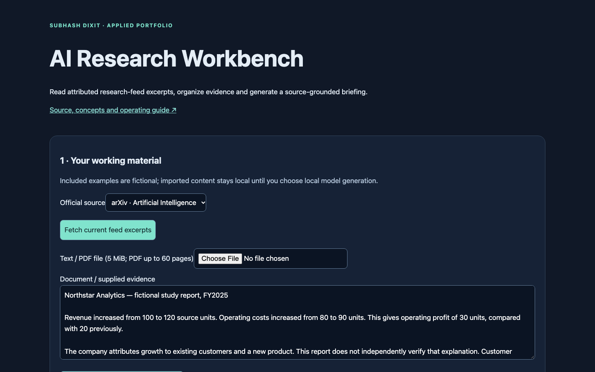
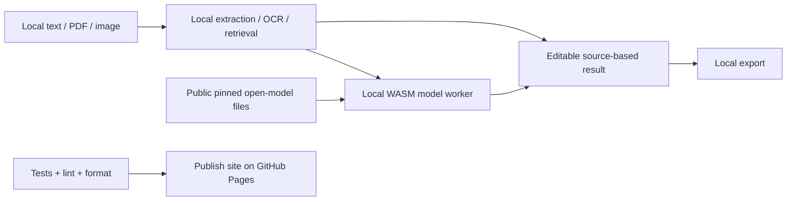
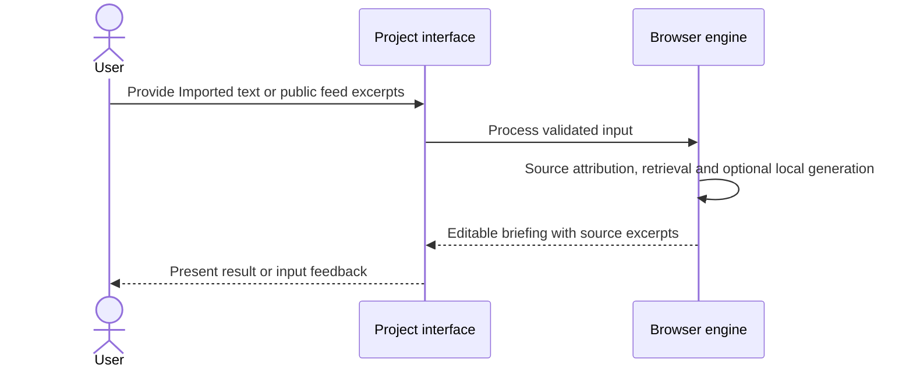
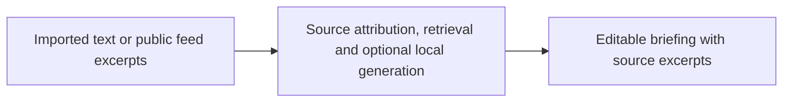

# AI Research Workbench

## 1. Project overview

Keyless browser AI research workbench with local Qwen generation, attributed feed excerpts and GitHub Pages.

[Live demo](https://subhashdixit.github.io/ai-research-workbench/) · [Source repository](https://github.com/subhashdixit/ai-research-workbench)



## 2. Motivation and problem statement

### Objective

Build a research briefing with excerpts the reader can trace to their source.

### Problem statement

Search results and model-written summaries can obscure where a claim came from.

### Motivation

Researchers need to review the underlying evidence before reusing a claim.

## 3. Solution and scope

**Inputs** — Imported text or public feed excerpts. **Outputs** — Editable briefing with source excerpts.

### What the finished application does

- A complete HTML/JavaScript workflow with included example, file import, editable outputs and local export.
- Local evidence/extraction mode with explicit algorithm labels.
- Keyless local open-model generation with explicit downloads, progress and cancellation.
- Input size limits, provider errors and source/citation checks shown in the UI.

## 4. Quick start and usage

### Use the application step by step

1. Open the live application. Read the input labels and scope panel.
2. Start with the included example to understand the output.
3. Replace it with your own supported input. Files are processed locally unless you explicitly choose a server feature and consent to it.
4. Run the analysis and inspect the visual output together with its limitations.
5. Export your results when the tool offers a download. Keep your own copy; a browser tab is not a durable data store.

## 5. High-level architecture

### Architecture and data flow



The Render gateway is used only by the research workbench's fixed-source news reader in the default setup. Its legacy optional Gemini adapter remains available in source for comparison, but the seven interfaces do not need it or call it for generation. No Gemini key setup is required. Qwen is the default text option; the smaller SmolLM2 option is a lower-memory experiment with substantially weaker instruction following. Generated numbers not found in evidence are flagged conservatively; this check is not mathematical or factual verification. A sleeping news gateway can delay feed retrieval; local document/model tools remain independent.

## 6. End-to-end request workflow



## 7. Data sources, inputs, and outputs

| Input | Processing | Output |
| --- | --- | --- |
| Imported text or public feed excerpts | Source attribution, retrieval and optional local generation | Editable briefing with source excerpts |

### Data provenance and attribution

Original source files are retained. Default analytical examples and the default invoice/profile are fictional. PDF.js 6.4.299 is Apache-2.0 licensed; its license is vendored with the worker.

## 8. Data flow and ETL pipeline



## 9. Low-level design and interfaces

Implementation entry points are [`site/index.html`](<site/index.html>), [`site/app.js`](<site/app.js>), [`site/documents.js`](<site/documents.js>), [`site/engine.js`](<site/engine.js>), [`site/local-model-worker.js`](<site/local-model-worker.js>), [`main.py`](<main.py>).

## 10. Concepts and algorithms

- **Evidence retrieval**. BM25 ranks source excerpts before optional generation. Its lexical scores can miss paraphrases.
- **Source attribution**. Keep publisher excerpts and their source identifiers with the briefing so readers can inspect the evidence.
- **Local generation**. A downloaded text model uses a bounded evidence context in a browser worker. Known source IDs make references inspectable, while factual support still requires reading the excerpt.

## 11. Technology choices and dependencies

- **HTML, CSS, and JavaScript**. Serve a static browser interface with inspectable rendering and validation.
- **PDF.js**. Read selectable PDF text locally while preserving page references.
- **Transformers.js and ONNX Runtime Web**. Run the optional downloaded model locally in a worker.

[Dependency versions and runtime rationale](DEPENDENCIES.md)

## 12. Training, inference, and evaluation

Review behavior using the checked-in fixtures and assertions. This application has no project-trained model benchmark.

Validation code is available in [`tests/assets.test.js`](<tests/assets.test.js>), [`tests/engine.test.js`](<tests/engine.test.js>), [`tests/model-policy.test.js`](<tests/model-policy.test.js>).

## 13. Limitations and data handling

### Practical limits

Text/context ≤40,000 characters; local generation questions ≤600; local documents ≤5 MiB/60 pages; images ≤2 MiB/16 megapixels. Only PNG/JPEG for image analysis. No persistent document store or cross-device history. Source extraction can change reading order in complex PDFs. OCR and AI output require manual verification. Images are analyzed, not generated. No API key is needed for any default generation function.

The test suite checks calculation contracts and invalid inputs. It cannot establish that an input dataset is representative, that a heuristic is scientifically correct for every domain, or that a result is suitable for an automated consequential decision. Read the original source alongside the maintained browser implementation when comparing behavior.

## 14. Installation and local setup

### Run locally from scratch

Install Node.js 22 and Python 3 for a local static HTTP server. Python is not a production backend for this app.

```bash
git clone https://github.com/subhashdixit/ai-research-workbench.git
cd ai-research-workbench
npm ci
npm test
npm run lint
npm run format
npm run check
python3 -m http.server 8000 --directory site
```

Open http://localhost:8000. Use HTTP rather than double-clicking HTML so that module imports and local data fetches work consistently. No production API secret belongs in `site/`.

### Local dependency installation

`requirements.txt` lists the complete supported production environment with exact `package==version` pins, including transitive dependencies. Use Python 3.11.17 in a fresh virtual environment:

```bash
python3.11 -m venv .venv
# Activate: source .venv/bin/activate (Windows: .venv\Scripts\activate)
python -m pip install -r requirements.txt
python -m pip check
```

For hash-verified installation and separate development environments, follow [DEPENDENCIES.md](DEPENDENCIES.md). Original prototype requirements are preserved at `archive/prototype-requirements.in` where present; they are not the supported install command.

## 15. Repository structure

### Coding structure

```text
site/
  index.html       # accessible application interface
  styles.css       # responsive design
  app.js           # interface orchestration
  engine.js        # validated calculations; no DOM dependency
  ui.js            # chart, CSV and download helpers
tests/             # behavior and boundary cases
.github/workflows/pages.yml
archive/           # original README and retired workflows where present
```

Original source files, notebooks and historical artifacts remain in the repository for comparison. The release publishes only `site/`; old source directories and datasets are not automatically exposed by the application.

## 16. Deployment and operations

### CI/CD and deployment

CI means continuous integration: each pull request and main-branch push installs exact lockfile dependencies, checks formatting, lints JavaScript, runs meaningful behavior tests and checks module syntax. A failed check stops publishing. CD means continuous deployment: after the required `Build and test` check succeeds on `main`, GitHub Actions uploads `site/` and GitHub Pages serves it over HTTPS.

The workflow uses pinned action revisions, minimal permissions and a protected main branch. Publishing jobs need Pages/OIDC permissions; test jobs only read source. Feature branches are deleted after merge. Static Pages hosting needs no always-running Python process, but cannot hide secrets, host a Flask process or provide durable server storage.

To set up a fork, enable GitHub Pages with **GitHub Actions** as its source and allow the repository's workflow to run. Repository Settings → Pages shows the deployment URL. If renaming the repository, update the README URL and any absolute links; application resources use relative paths. Check Actions logs if publishing fails.

#### Release, monitoring and rollback

A commit identifies exactly which source was deployed. Inspect the Actions deployment and test results before sharing the link. After publishing, open the page, run its example and check exports; a successful HTTP response alone is not a functional test. For rollback, revert the faulty merge in a new PR, pass checks, and merge the revert. This triggers the same reproducible publishing process. Avoid force-pushing protected main or deleting history. Browser caches can retain an older asset briefly; refresh after a deployment.

#### Docker and alternatives

Docker packages code and dependencies into a reproducible runtime. This static app does not require a container: Pages serves the same versioned files directly, with less operating work and no container cold starts. A container becomes useful if adding a Python backend; then secrets, patches, resource costs and persistent storage require separate management.

### Gateway backend: run, test and deploy

Requires Python 3.11+. From the repository root:

```bash
python3.11 -m venv .venv
source .venv/bin/activate
python -m pip install --require-hashes --only-binary=:all: -r backend/requirements-dev.lock.txt
python -m pytest -q backend
python -m black --check backend
python -m pylint --rcfile backend/pyproject.toml backend/ai_gateway backend/wsgi.py
gunicorn --chdir backend --bind 127.0.0.1:8001 --workers 1 --threads 4 wsgi:app
```

Create a Render Blueprint from this repository using `render.yaml`, verify the plan is Free and deploy. The gateway can start without a Gemini key: health and fixed-source news reading work, while generation explicitly returns 503. Set `GEMINI_API_KEY` directly in Render Environment when ready. Configure a Gemini API project with the intended quota/billing settings; server limits are not a billing guarantee.

`POST /api/ai` accepts JSON `{tool, context, question, consent: true}` plus optional `{image: {mimeType, data}}` for invoice/multimodal only. Tools are research, summary, invoice, multimodal, equity, faq and cover-letter. Use a consented synthetic request to verify actual provider access. Request bodies are capped at 4 MiB, image base64 at 3 MiB, text at 40,000/4,000 characters. Rate limits: 4/client/minute, 40 shared/hour and 2 concurrent calls in the single worker. Restarting resets these in-memory limits. CORS is an origin control, not authentication; non-browser clients can still reach the public rate-limited API.

`GET /api/news?feed=arxiv-ai` (also arxiv-ml/openai) fetches only hardcoded official feeds. No user-supplied URL is fetched. XML entity expansion is disabled, response size is bounded, source markup is stripped, unsafe links are rejected, and cache expires after ten minutes.

Backend tests use a fake transport to check validation, consent, response redaction, CORS, image bounds, unsafe feeds and quota enforcement. Mocked tests do not prove the live Google model works; that requires a real configured provider request.

## 17. License, credits, and support

[Repository code license](LICENSE). Report reproducible issues through [GitHub Issues](https://github.com/subhashdixit/ai-research-workbench/issues).
